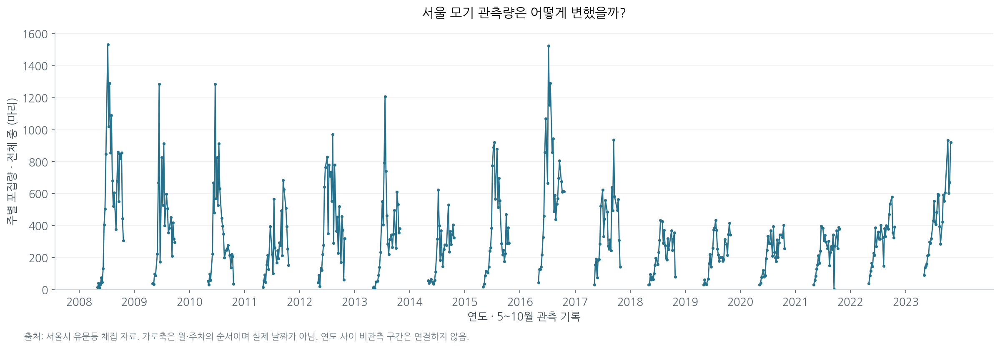
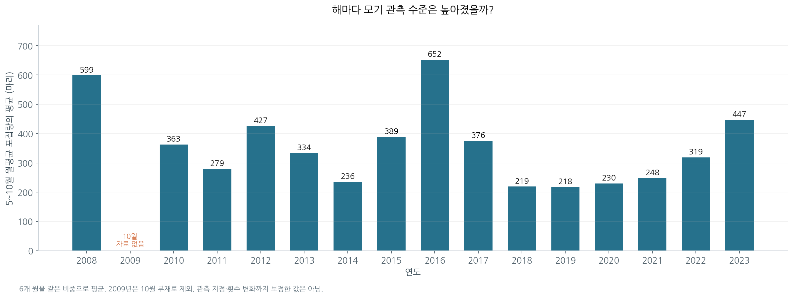
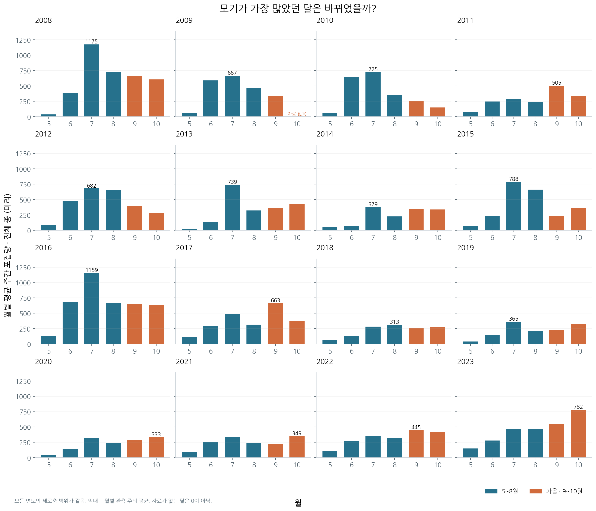

# 모기는 줄어든 걸까, 나타나는 시기가 달라진 걸까?

서울시 유문등 채집 자료로 살펴본 모기 관측량의 변화

> **업데이트 1: 모기 관측량 분석 결과.** 2008~2023년 원자료를 정제하여 분석했다. 이 보고서의 수치와 그래프는 실제 계산 결과다. 기상 자료는 수집 연결 문제로 확보하지 못했으므로, 기온·강수량·습도와의 관계는 이번 결과에 포함하지 않는다. 전체 미션의 최종 제출본은 아니다.

## 1. 분석 주제와 선정 이유

여름에 모기에 덜 물린 것 같다는 경험에서 질문이 시작됐다. 폭염으로 모기가 줄었다거나 가을에 다시 많아진다는 이야기를 듣고, 실제 관측량도 줄었는지, 혹은 많이 나타나는 시기가 달라졌는지 확인하고자 했다.

뉴스와 풍문은 검증할 가설로 두었다. 먼저 모기 관측 자료에서 변화가 있는지 확인하고, 이후 같은 지역·기간의 기상 자료와 비교하는 순서로 분석한다. 포집량을 사람의 물림 횟수로 해석하지 않는다.

## 2. 분석 질문

1. 매년 5~10월 모기 관측량의 전체 수준과 월별 발생 양상은 어떻게 변했는가?
2. 같은 기간 기온은 어떻게 변했으며, 모기 관측량과 어떤 관계를 보이는가?
3. 기온만으로 설명하기 어려운 변화가 있는가? 강수량·습도와는 어떤 관계를 보이는가?

이번 업데이트는 첫 번째 질문에 답한다. 두 번째·세 번째 질문은 기상 자료를 확보한 뒤 분석하며, 아직 답을 내리지 않았다.

## 3. 데이터 설명

| 항목 | 내용 |
|---|---|
| 제공기관 | 서울특별시 보건환경연구원 |
| 원본 | 2008_2023년 유문등자료.xlsx |
| 프로젝트 경로 | data/raw/mosquito_2008_2023.xlsx |
| 기간·지역 | 2008~2023년, 서울 |
| 원본 구성 | 연도별 16개 시트, 월·주차가 적힌 기록 480행 |
| 분석 범위 | 5~10월 기록 408행 |
| 월별 집계 | 95행: 16년 × 6개월에서 2009년 10월 1개 제외 |
| 주 분석값 | 원본의 ‘모기 계’ 또는 ‘계’에 기록된 전체 종 포집량 |
| 보조 보존값 | 빨간집모기 포집량 |
| 이용 조건 | 공공누리 제1유형, 출처 표시 |

출처: [서울 열린데이터광장 — 서울시 감염병매개 모기 개체수 및 종별 분류 결과](https://data.seoul.go.kr/dataList/OA-22301/F/1/datasetView.do)

‘관측량’은 유문등으로 채집하여 기록한 수다. 전체 모기 개체수의 추정치나 사람의 물림 횟수가 아니다. 원본에 정확한 일자가 아닌 ‘몇 월 몇 주’가 기록되어 있으므로 임의로 채집일을 만들어 넣지 않았다.

원본을 보존하고 분석 단계에서 5~10월을 선택했다. 따라서 11월 이후 발생 양상은 이번 결론의 범위 밖이다. 원본에는 연도별 관측 지점·실제 가동 횟수에 대한 일관된 분모가 없어, 장기 비교를 관측 노력까지 보정한 개체군 추세로 해석할 수 없다.

## 4. 데이터 정제와 분석 방법

### 4.1. 실제 확인한 문제와 처리

| 확인 사항 | 처리와 근거 |
|---|---|
| 연도마다 열 위치와 제목 행이 다름 | ‘채집일’, ‘계/모기 계’, ‘빨간집모기’ 제목으로 열을 찾았다. 고정된 열 번호로 모든 시트를 읽지 않았다. |
| 제목·설명·연간 총계가 관측 행과 함께 존재 | 월·주차 형식의 행만 추출하여 합계를 이중 집계하지 않았다. |
| 2009년 10월 기록 없음 | 월별 그림에는 빈칸으로 표시. 5~10월 연도별 평균 및 여름·가을 비교에서는 제외했다. 0으로 채우지 않았다. |
| 월별 관측 주 수 차이 | 월별 합계보다 월별 관측 주의 평균을 사용하고, 연도 지표는 6개 월을 같은 비중으로 평균했다. |
| 2010년 4월 1주·5주의 종별 칸이 모두 비어 있고 합계만 0 | 실제 0마리인지 불명확한 기록으로 표시. 분석 대상인 5~10월에는 포함되지 않는다. |
| 2017년 10월 4주의 일부 종별 칸 1개 공란 | 해당 칸을 0으로 대체하지 않았다. 주 분석에 필요한 원본 합계 310마리와 빨간집모기 284마리는 존재하므로 해당 기록을 유지했다. |
| 연도·월·주차 중복 | 중복 0건 확인. |
| 선택한 408행의 전체 합계·빨간집모기 값 | 결측 0건 확인. |
| 큰 관측값 | 자동 삭제하지 않았다. 최대값인 2008년 7월 2주 1,533마리도 원본 기록으로 유지했다. |

‘월이 모두 있다’는 뜻이 ‘예정된 모든 관측이 이루어졌다’는 뜻은 아니다. 기록이 없는 주를 임의로 보간하지 않았고, 월별 관측 횟수는 `mosquito_monthly.csv`의 `weeks_observed`로 남겼다.

### 4.2. 적용한 시계열 기법

**월별 집계:** 월별 평균 = 해당 월 포집량 합계 ÷ 해당 월 관측 주 수. 어느 달에 모기가 많았는지 비교하기 위해 적용했다. 예를 들어 2023년 10월은 (933 + 603 + 670 + 920) ÷ 4 = **781.5마리**다.

**전년 대비 변화율:** (올해 관측 수준 ÷ 전년 관측 수준 − 1) × 100. 연도별 증감의 크기를 비교한다. 여기서 연도별 관측 수준은 **5~10월의 월별 평균 6개를 다시 평균한 값**이다. 이전 연도가 불완전하면 변화율을 계산하지 않는다. 그래서 2009년뿐 아니라 2010년의 전년 대비 변화율도 표시하지 않는다.

월을 같은 비중으로 평균한 값은 전체 관측 주를 한 번에 평균한 값과 다르다. 예를 들어 2023년은 전자가 **447.47마리**, 후자가 **436.50마리**다. 본 보고서의 연도 비교에는 전자를 일관되게 사용한다. 이 집계는 월별 기록 횟수의 가중치 차이를 줄이지만, 포집기 수나 가동 조건의 차이까지 보정하지는 못한다.

이동평균과 예측모형은 사용하지 않았다. 전체 흐름은 원자료 선그래프와 연도별 막대로, 발생 시기는 월별 막대로 설명한다.

## 5. 분석 결과와 시각화

### 5.1. 전체적인 흐름: 지속적인 증가로 단정하기 어렵다

연도 안에서 관측량이 오르내리는 양상이 반복되지만, 매년 같은 높이로 발생하지 않는다. 분석 범위의 주간 최고 관측값은 **2008년 7월 2주 1,533마리**다. 비관측 겨울을 0으로 연결하지 않았으며, 가로축은 원본 월·주차의 순서를 표시한다.

2008년 관측 수준은 **598.68마리**, 2016년은 **652.48마리**, 2019년은 **218.14마리**, 2023년은 **447.47마리**다. 2023년은 2019년보다 **105.1% 증가**했지만, 2008년보다는 **25.3% 낮다**. 따라서 분석 시작점을 어디에 두느냐에 따라 증감 설명이 달라진다.

| 연도 | 5~10월 관측 주 수 | 월평균의 평균(마리) | 전년 대비 | 최대 관측 월 |
|---|---:|---:|---:|---:|
| 2008 | 27 | 598.67 | — | 7월 |
| 2009 | 21 | 비교 제외 | — | 7월(5~9월 중) |
| 2010 | 25 | 363.08 | — | 7월 |
| 2011 | 25 | 279.33 | -23.1% | 9월 |
| 2012 | 27 | 426.55 | +52.7% | 7월 |
| 2013 | 26 | 334.06 | -21.7% | 7월 |
| 2014 | 25 | 235.68 | -29.5% | 7월 |
| 2015 | 26 | 388.56 | +64.9% | 7월 |
| 2016 | 26 | 652.48 | +67.9% | 7월 |
| 2017 | 25 | 375.55 | -42.4% | 9월 |
| 2018 | 26 | 219.05 | -41.7% | 8월 |
| 2019 | 26 | 218.14 | -0.4% | 7월 |
| 2020 | 25 | 230.22 | +5.5% | 10월 |
| 2021 | 26 | 248.06 | +7.7% | 10월 |
| 2022 | 26 | 318.80 | +28.5% | 9월 |
| 2023 | 26 | 447.47 | +40.4% | 10월 |

2009년은 10월이 없으므로 연간 수준을 비교하지 않았다. 표의 최대 월은 월평균 기준이며, 가장 큰 단일 주의 발생 월과는 다를 수 있다.

### 5.2. 발생 시기: 최근 4년의 월별 정점은 가을이었다

모든 패널의 세로축을 동일하게 맞췄다. 우측 하단 범례에서 청색은 5~8월, 주황색은 가을(9~10월)을 뜻한다. 숫자는 각 연도에서 월평균이 가장 큰 막대의 값이다. 2009년 10월의 빈칸은 0마리가 아니라 자료 부재다.

2020년과 2021년의 정점은 **10월**, 2022년은 **9월**, 2023년은 **10월**이었다. 반면 2019년 정점은 **7월**이었다. 따라서 최근 4개 연도에는 가을 정점이 연속해서 관찰된다. 다만 과거에도 2011년과 2017년은 9월 정점이었으므로, ‘가을 모기가 최근에 처음 생겼다’고 말할 수는 없다.

### 5.3. 여름과 가을: 총량보다 같은 기준의 평균을 비교해야 한다

여름을 6~8월, 가을을 9~10월로 정의했다. 기간 길이가 서로 다르므로 각 계절의 **월평균 관측량을 다시 평균**하여 비교했다. 5월은 연도 비교에는 포함하지만 이 계절 비교에는 포함하지 않았다.

2023년 여름 평균은 **403.02마리**, 가을 평균은 **662.88마리**로 가을이 약 **1.64배**였다. 2016년은 여름 **834.05마리**, 가을 **640.75마리**로 가을이 약 **0.77배**였다. 같은 비교 기준에서 여름·가을의 상대적인 수준이 달라졌음을 확인할 수 있다.

이 관찰은 발생 양상의 변화에 대한 근거다. 부화 시점이나 폭염의 영향을 직접 측정한 결과는 아니다.

## 6. 인사이트

| 관찰: 수치와 근거 | 해석 | 추가 판단의 한계 |
|---|---|---|
| 2023년 447.47마리는 2019년보다 105.1% 높지만 2008년보다 25.3% 낮다. 연도별 막대 참고. | 최근의 증가와 장기간의 일관된 증가는 서로 다른 주장이다. | 포집 노력 차이가 확인되지 않아 실제 개체군 변화율로 단정할 수 없다. |
| 2020~2023년의 월별 정점은 모두 9~10월이다. 월별 막대 참고. | 최근 관측 자료에서는 가을에 많이 나타나는 양상이 반복된다. | 이것만으로 부화가 지연됐다거나 폭염이 원인이라고 설명할 수 없다. |
| 2023년 가을/여름 평균 비율은 1.64배, 2016년은 0.77배다. 월별 막대 및 계절 집계 참고. | 전체적인 증감 외에 여름과 가을 사이의 분포 변화도 함께 봐야 한다. | 9~10월로 가을을 정의했으므로 11월 이후는 포함하지 않는다. |

## 7. 결론과 한계

서울시 유문등 기록에서는 **2019년 이후 관측 수준이 상승했고, 2020~2023년은 가을에 월별 정점이 나타났다.** 그러나 2008~2023년 전체를 두고 모기 관측량이 지속적으로 증가했다고 말하기는 어렵다. ‘전체 양이 늘었는가’와 ‘많이 나타나는 시기가 달라졌는가’를 나누어 볼 필요가 있다.

기상 자료를 결합하지 않은 현재 분석으로는 폭염 가설을 검증할 수 없다. 관측량이 기온과 같이 움직이는지, 강수량·습도와 관련이 있는지도 아직 결론이 없다.

주요 한계는 관측 지점·가동 횟수의 연도별 변화 미확인, 일부 관측 주와 2009년 10월의 부재, 5~10월로 한정된 기간이다. 원본 값이 정확히 옮겨졌다는 검증과 연도별 관측 조건이 같다는 검증은 다르다. 또한 단순 상관이 확인되더라도 계절성·시간차·방역·서식 환경 등을 분리하지 않으면 원인으로 단정할 수 없다.

**시계열 개념:** 트렌드는 장기간의 수준 변화이며, 이 자료에서는 최근 상승과 장기 변동을 구분해야 한다. 계절성은 해마다 특정 시기에 반복되는 양상으로 월별 막대에서 살펴봤다. 노이즈는 반복적인 양상만으로 설명되지 않는 불규칙한 변동을 뜻한다. 모든 불규칙한 값이 측정 오류인 것은 아니며, 이번에는 통계적 분해로 이 세 성분을 따로 추정하지 않았다.

## 8. AI 사용 로그와 검증

| 사용 작업 | 사용 이유 | 실제 검증 |
|---|---|---|
| 분석 설계 | 질문과 방법을 연결하기 위해 | 사용자와 질문 순서, 5~10월, 막대그래프, 이동평균 제외를 확정했다. |
| 원본 구조 확인·전처리 코드 | 16개 시트의 서로 다른 구조를 처리하기 위해 | 실제 헤더와 월·주차 행을 확인했다. 원본 시트·행 번호를 CSV에 보존했다. |
| 집계·시각화 코드 | 반복 계산과 그래프 생성을 재현하기 위해 | 스크립트를 실행했다. 분석 대상 408행의 합계 145,613마리와 월별 합계의 합을 대조했다. 2023년 10월 4개 원본 값으로 평균 781.5마리를 독립 검산했다. |
| 결과 해석·문장 정리 | 관찰과 가설을 구분하기 위해 | 연도별 집계표와 그래프의 수치를 대조했다. 기온이나 부화에 관한 원인 설명을 결론에 넣지 않았다. |

정제 검사 결과는 `data/processed/quality_check.json`에, 라이브러리 버전과 실행법은 `requirements.txt`와 `README.md`에 기록했다.

## 9. 강의에서 설명할 핵심

“모기가 줄어든 것 같다는 경험으로 출발했지만, 실제로는 최근 관측량이 늘었고 가을에 정점이 나타났다. 그렇다고 모든 기간에서 증가한 것은 아니었다. 먼저 자료가 말하는 변화를 확인한 뒤, 그 변화가 날씨와 관련되는지 다음 질문을 던졌다.”

학생에게는 ① 원본에서 무엇을 관측했는지 확인한 과정, ② 2009년 10월을 0으로 채우지 않은 이유, ③ 월평균과 변화율을 선택한 이유, ④ 그래프의 수치와 원인 가설을 구분한 과정을 보여준다.
